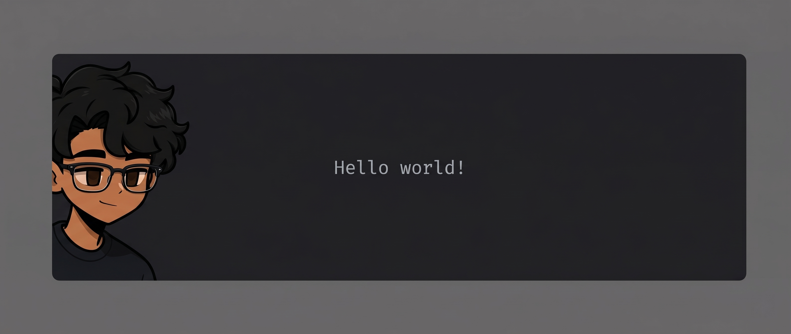

## About me 😊

Hey! I'm Abhay, a Software Engineering student and developer who enjoys turning ideas into real, working software. I'm interested in programming, web development, and blockchain technology, especially building decentralized applications. I spend a lot of my time experimenting with new technologies, building personal projects, and understanding how things work behind the scenes rather than simply using them. I enjoy working on everything from full-stack web applications to Web3 experiments.

## Tech Stack ⚙️

I'm a full-stack developer with a strong foundation in core programming languages. I started with **C, C++, Java, and Python**, which taught me data structures, problem solving, and how software works at a low level. On the web, I build responsive, interactive interfaces with **HTML, CSS, JavaScript, and React**, and power them with **Node.js** backends and **PostgreSQL** databases. I'm also exploring **Web3 and DApps**, building applications that run on blockchain networks.
